

|[:skull:ISSUE](https://github.com/frankyhub/Calli-Bot/issues?q=is%3Aissue)|[:speech_balloon: Forum /Discussion](https://github.com/frankyhub/Calli-Bot/discussions)|[:grey_question:WiKi](https://github.com/frankyhub/Calli-Bot/wiki)||
|--|--|--|--|
| | | | |
<a href="https://github.com/frankyhub/Calli-Bot/issues">|<a href="https://github.com/frankyhub/Calli-Bot/discussions">|<a href="https://github.com/frankyhub/Calli-Bot/6eleases">||
|| <a href="https://github.com/frankyhub/Calli-Bot/pulse" alt="Activity">| <a href="https://github.com/frankyhub/Calli-Bot/graphs/traffic">  |<a href="https://github.com/frankyhub?tab=stars"> ||

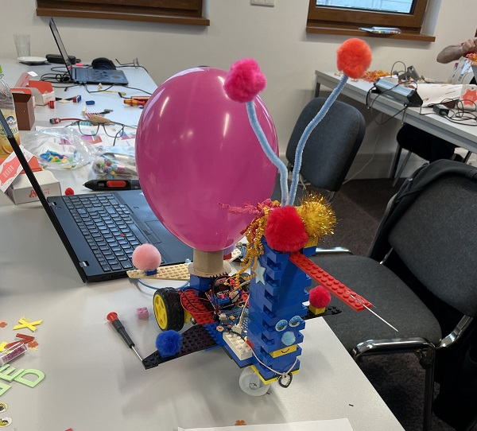 
   

       

## Story

Zwei Calliope (Sender und Empfänger) steuern einen Bot

Jedes Team baut einen Calli-Bot. Der Calli-Bot (Empfänger) ist mit einem Luftballon und einer Nadel ausgestattet.
Ziel ist es, mit der Nadel des Bots den gegnerischen Luftballon zum platzen zu bringen.
Verliert ein Bot seinen Luftballon oder platzt der Luftballon durch Eigenverschulden, scheidet der Bot aus.
Der Bot darf die Arena nicht verlassen, ansonsten scheidet er aus.
Gesamtsieger ist das Team, das als einziges noch einen aufgeblasenen Luftballon am Bot hat.
Bei Unstimmigkeiten entscheidet das Schiedsrichterteam.

---

## Die Callenge

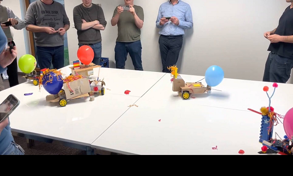 
   

---

## Calli-Bots

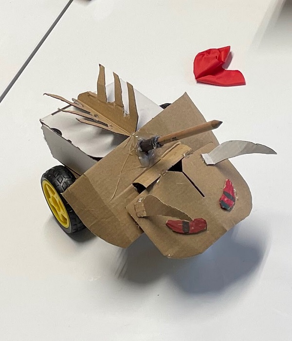 
   
       
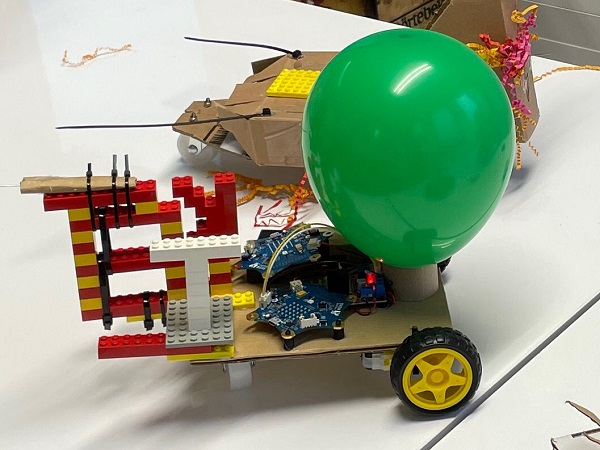 
   

       
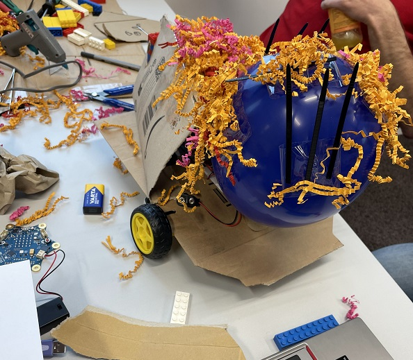 
   

---

## Calli-Bot Aufbau

| Stueck | Bezeichnung | 
| -------- | -------- | 
| 2       | Calliope        | 
| 1        |JST PH 4PIN       | 
| 1        | 3D-Druck Calliope Füße        | 
| 1        | 3D-DruckL298H Füße       |
| 1      | Nadel (Lanze)      |
| 1      |  9V-Batterie     |
| 2       | Getriebemotore      |
| 2       | Räder     |
| 1       | H-Brücke L298N     |
| 1      | 9V-Case       |
| 10       | Kabelbinder      |
| 1      | Luftballon-Ring      |
| 1       | Luftballon-Ringorderrad      |
| 1       | Kleber      |

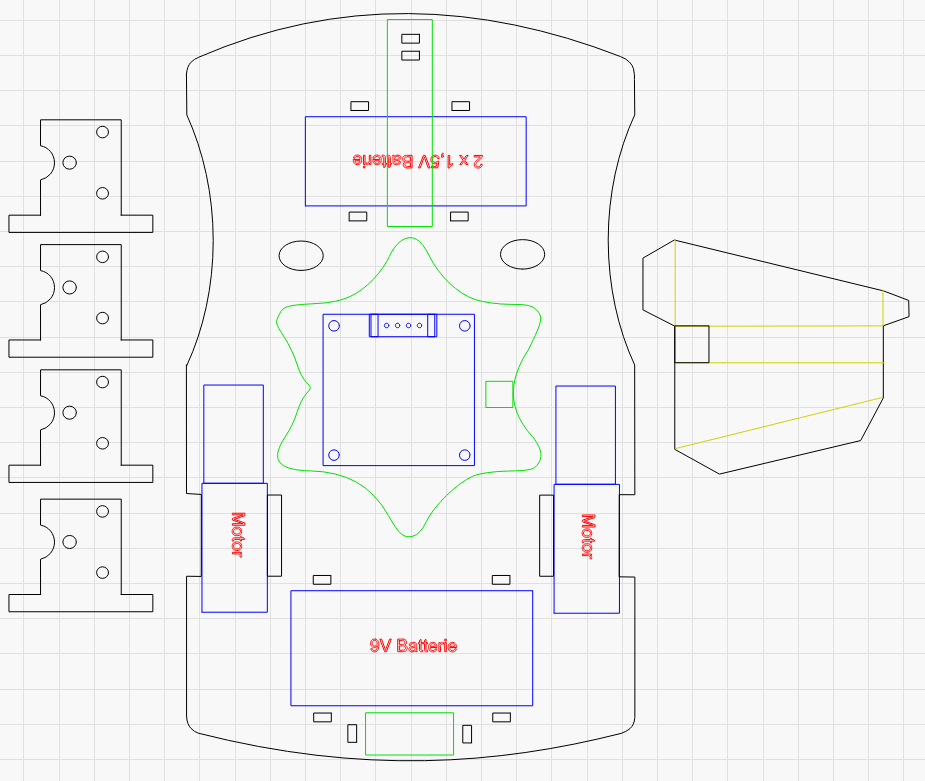 
   

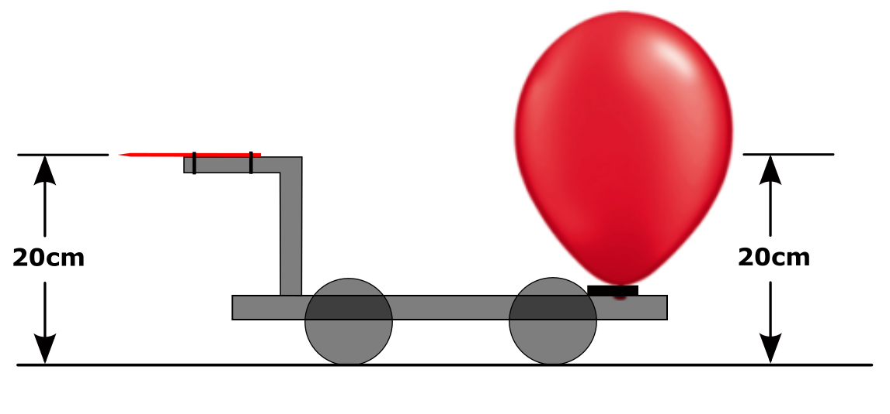 
   

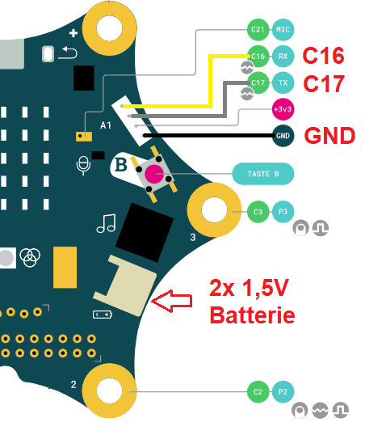 
   

 
   

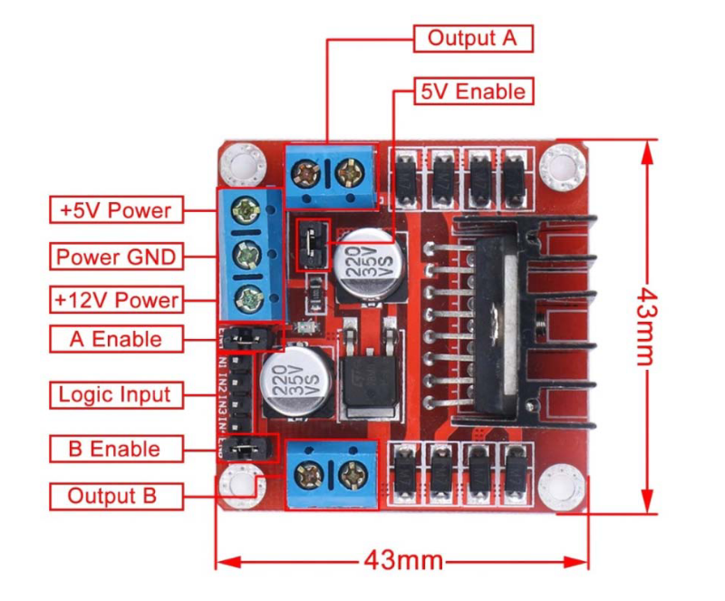 
   

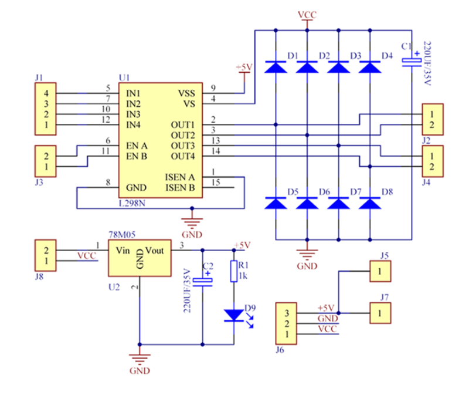 
   

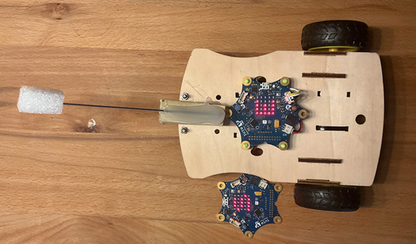 
   

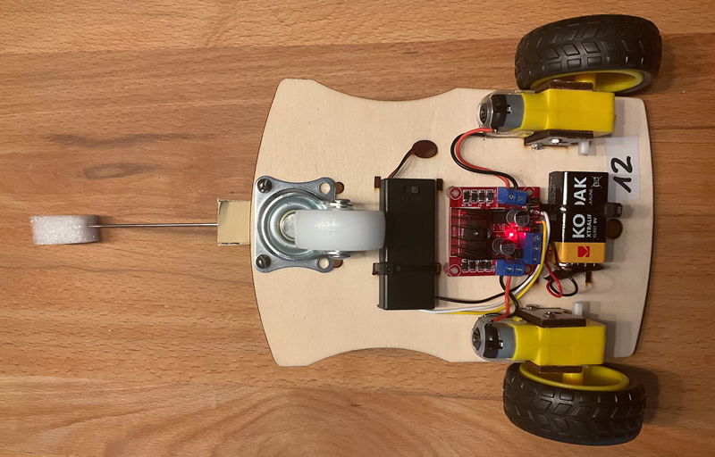 
   

---

   
<ol class="breadcrumb" style="border-top: 2px solid black;border-bottom:2px solid black; height: 45px; width: 900px;"> 
<a href="#oben">nach oben</a>
</ol>

 

---
